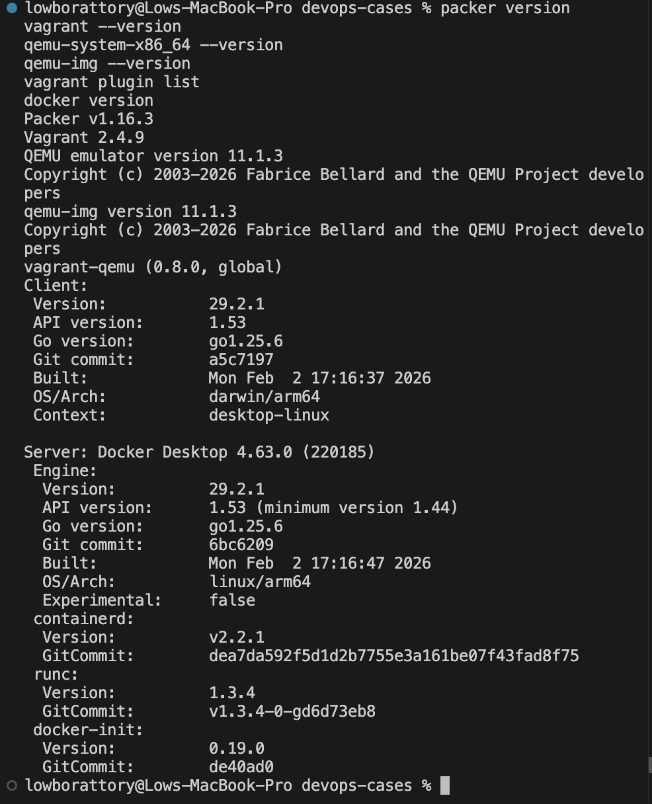
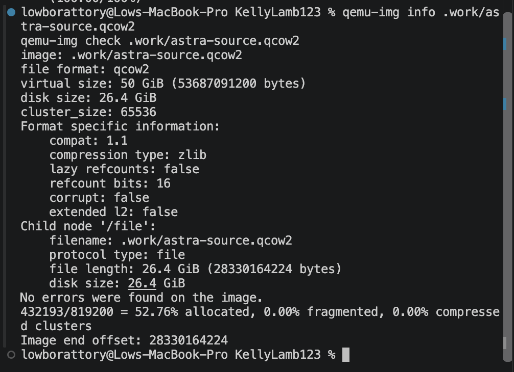
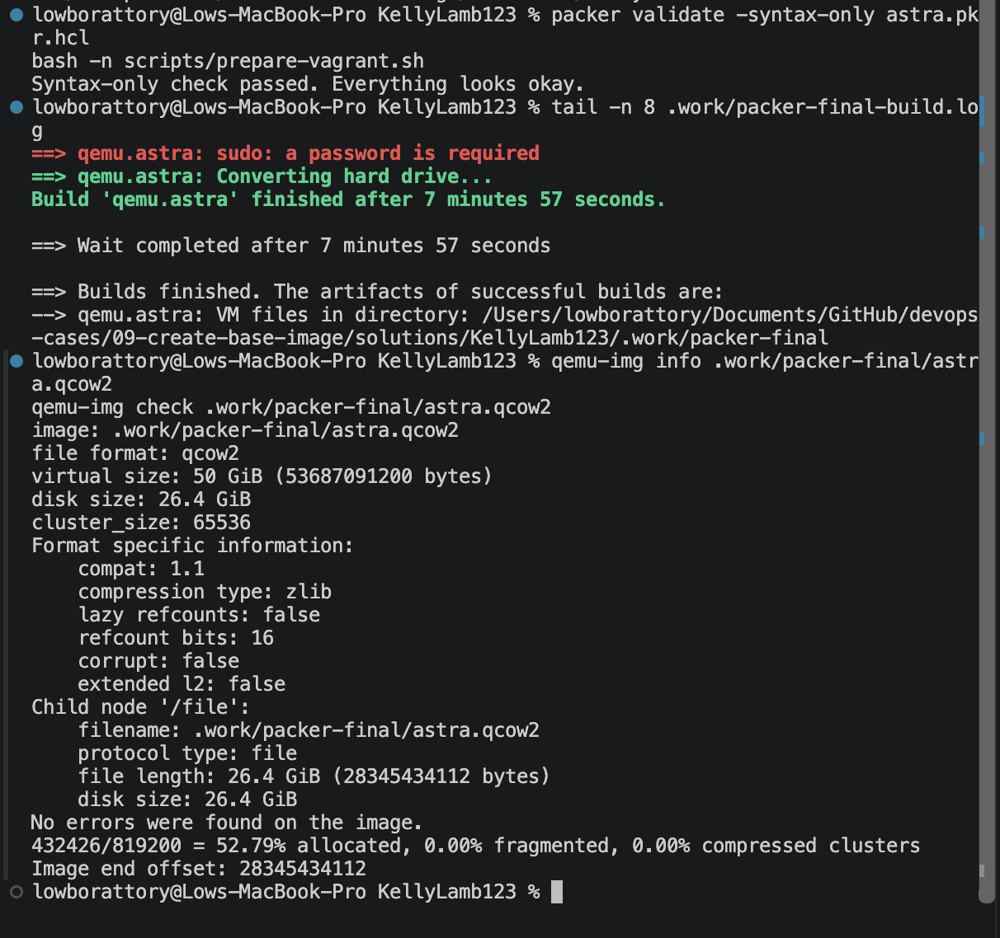
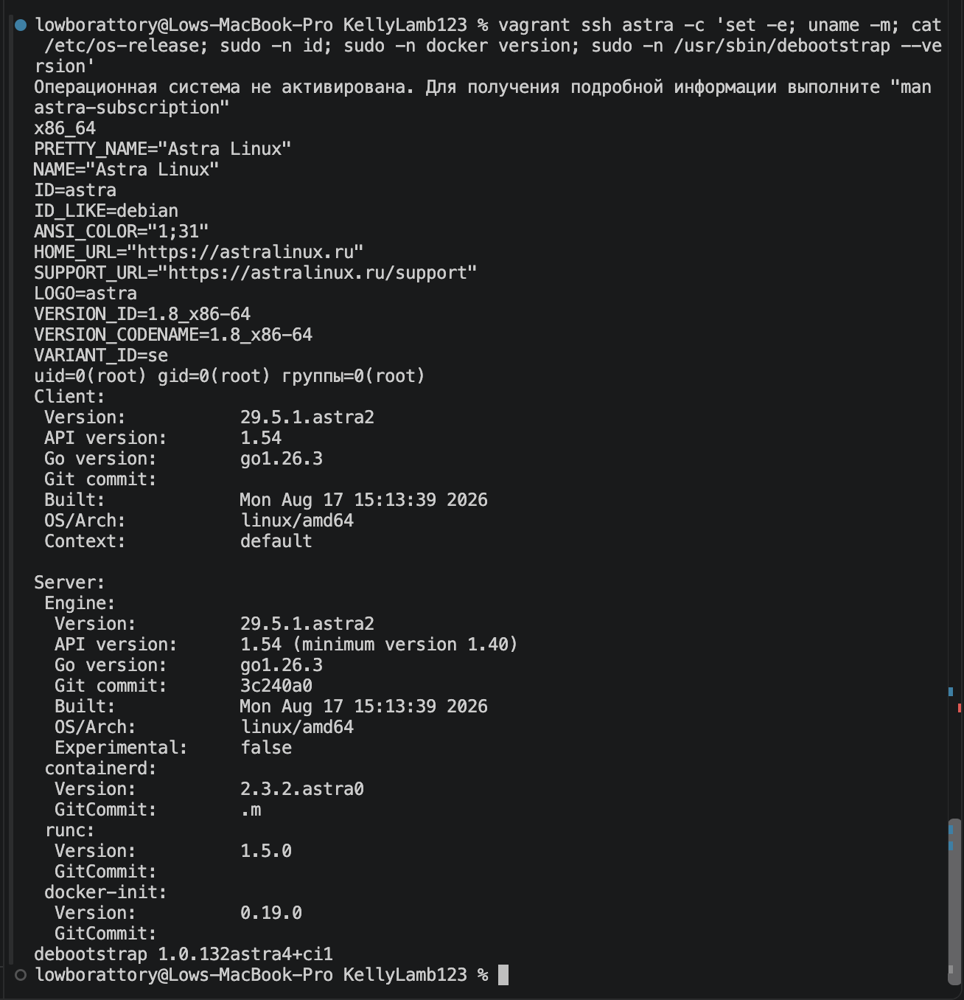
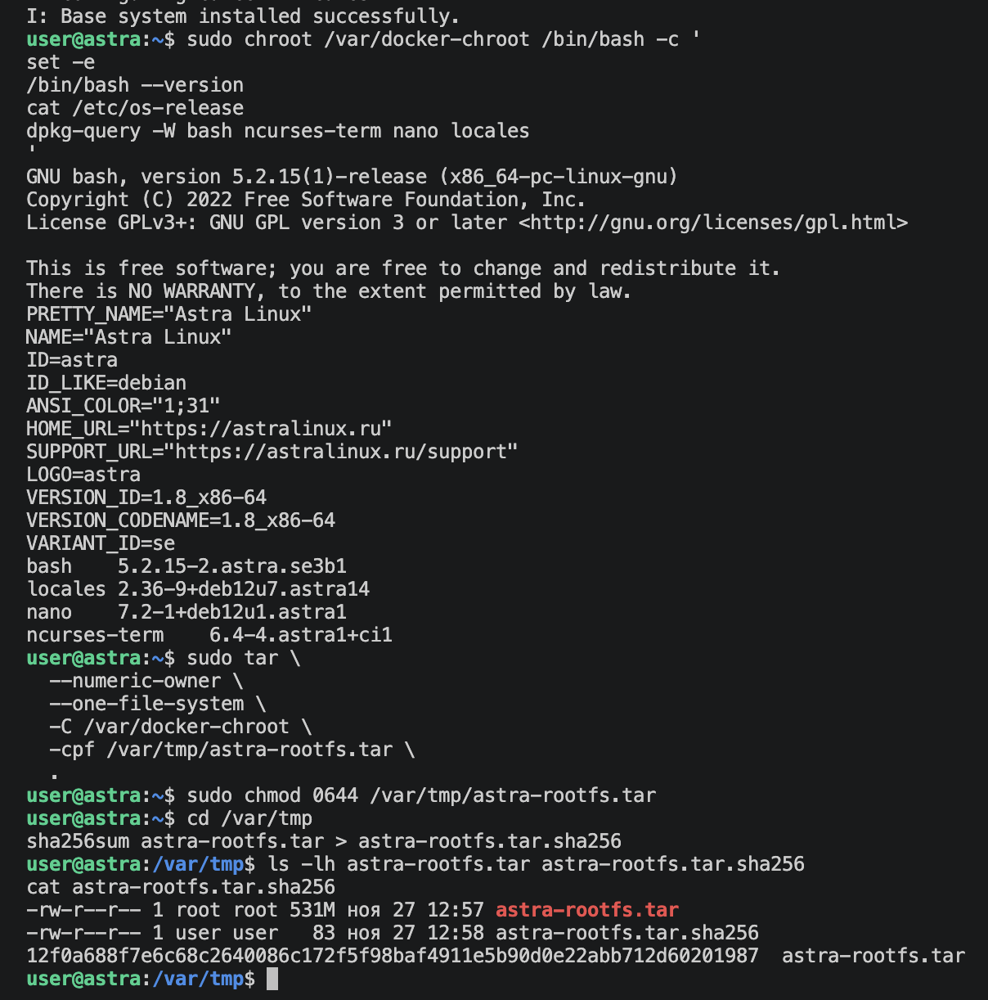
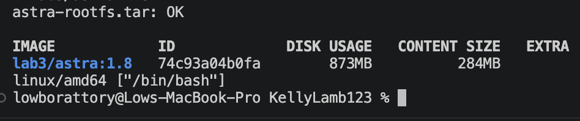
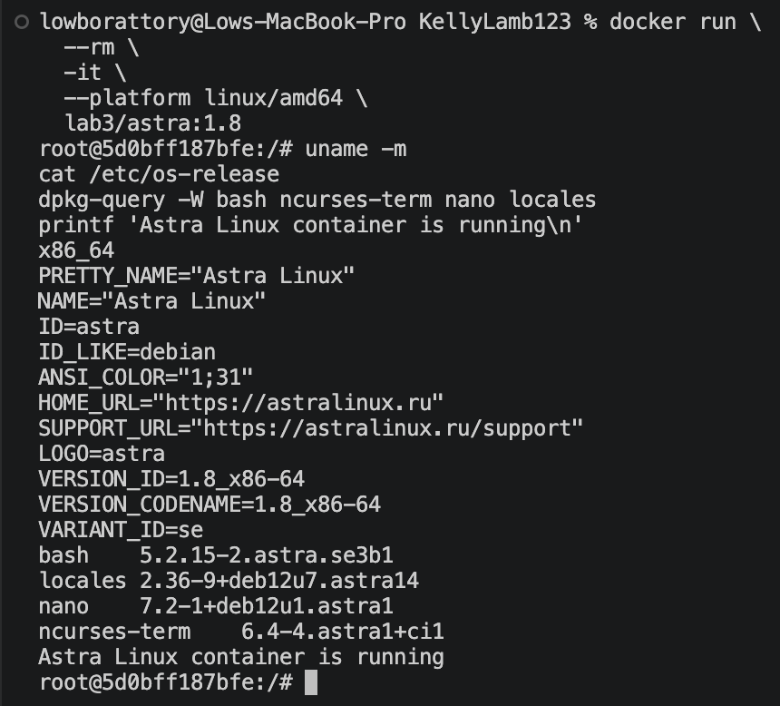

Решение для macOS на Apple Silicon с использованием Packer, Vagrant и QEMU.

## Рабочая среда

- Packer 1.16.3.
- Packer QEMU plugin 1.1.8.
- Vagrant 2.4.9.
- vagrant-qemu 0.8.0.
- QEMU 11.1.3.
- Docker Desktop.
- Astra Linux SE 1.8.6.39 «Орёл» из EasyAstra.

Гостевая система x86_64 выполняется через эмуляцию TCG.

## Файлы

- `astra.pkr.hcl` — подготовка образа через Packer.
- `scripts/prepare-vagrant.sh` — SSH-ключ, sudo и режим загрузки.
- `Vagrantfile` — запуск гостя и установка необходимых пакетов.
- `screenshots` — подтверждения выполнения.

Локальные диски, ключи, архивы и состояние Vagrant находятся
в игнорируемых каталогах `.work` и `.vagrant`.

Все команды Mac выполняются из папки этого решения.

## Подготовка исходной машины

С портала https://easyastra.ru/ скачан образ Astra Linux SE 1.8 «Орёл».
В работе скачанный OVA/TAR имеет имя
`Astra-Linux-1.8.6.39-SE-orel.tar`.

При воспроизведении с нуля:

```bash
mkdir -p .work/source .work/packer

tar -xf "$HOME/Downloads/Astra-Linux-1.8.6.39-SE-orel.tar" \
  -C .work/source

qemu-img convert -p \
  -f vmdk \
  -O qcow2 \
  .work/source/Astra-Linux-1.8.6.39-SE-orel-disk001.vmdk \
  .work/packer/astra.qcow2

ssh-keygen -t ed25519 \
  -f .work/id_ed25519 \
  -N "" \
  -C "lab3-astra"
```

При существующих файлах диска и ключа их не следует перезаписывать.

Для первоначального включения SSH машина запускается на Mac:

```bash
qemu-system-x86_64 \
  -name astra-lab3 \
  -machine pc \
  -accel tcg \
  -cpu max \
  -smp 2 \
  -m 4096 \
  -drive file=.work/packer/astra.qcow2,format=qcow2,if=ide \
  -nic user,model=e1000,hostfwd=tcp:127.0.0.1:2222-:22 \
  -display none \
  -vnc 127.0.0.1:19 \
  -monitor stdio
```

В другом терминале Mac:

```bash
open -a TigerVNC --args \
  -Shared \
  -SecurityTypes None \
  127.0.0.1::5919
```

После входа в Astra Linux под исходным пользователем `user`
с паролем из карточки EasyAstra в гостевом терминале выполняются:

```bash
sudo apt-get update --error-on=any
sudo apt-get install -y openssh-server sudo
sudo systemctl enable --now ssh
sudo systemctl set-default multi-user.target
sudo /sbin/shutdown -P now
```

Перед запуском Packer необходимо дождаться выключения QEMU.

## Packer

В терминале Mac с zsh:

```bash
read -r -s "PKR_VAR_astra_password?Пароль пользователя user: "
export PKR_VAR_astra_password

PKR_VAR_source_sha256="$(shasum -a 256 .work/packer/astra.qcow2 | awk '{print $1}')"
export PKR_VAR_source_sha256

packer init astra.pkr.hcl
packer validate astra.pkr.hcl
packer build astra.pkr.hcl

unset PKR_VAR_astra_password

qemu-img check .work/packer-final/astra.qcow2
```

Исходный диск должен быть выключен.
Папка `.work/packer-final` до новой сборки должна отсутствовать.
Для обычного продолжения работы повторная сборка не требуется.

Результат: `.work/packer-final/astra.qcow2`.

В первоначальной сборке выключение было выполнено вручную из-за
порядка правил sudoers в Astra Linux. Затем сценарий исправлен:
правило NOPASSWD явно подключается после остальных правил,
а шаблон проверяет sudo после сброса кэша авторизации.
Исправление и беспарольное выключение проверены на готовом образе.

## Vagrant

```bash
vagrant validate
vagrant up astra --provider=qemu
vagrant status
vagrant ssh astra
```

Vagrant использует результат Packer и устанавливает
`docker.io` и `debootstrap`.

Во время обращений к репозиториям Astra Linux VPN на Mac был выключен,
поскольку при работе с ним наблюдалась ошибка разрешения имени.

## Создание файловой системы

Внутри гостевой Astra Linux:

```bash
sudo debootstrap \
  --arch=amd64 \
  --include=ncurses-term,nano,locales \
  --components=main,contrib,non-free \
  1.8_x86-64 \
  /var/docker-chroot \
  http://dl.astralinux.ru/astra/stable/1.8_x86-64/repository-main
```

Проверка chroot:

```bash
sudo chroot /var/docker-chroot /bin/bash -c '
set -e
/bin/bash --version
cat /etc/os-release
dpkg-query -W bash ncurses-term nano locales
'
```

Архивирование и контрольная сумма:

```bash
sudo tar \
  --numeric-owner \
  --one-file-system \
  -C /var/docker-chroot \
  -cpf /var/tmp/astra-rootfs.tar \
  .

sudo chmod 0644 /var/tmp/astra-rootfs.tar

cd /var/tmp
sha256sum astra-rootfs.tar > astra-rootfs.tar.sha256

exit
```

## Передача на Mac

```bash
vagrant ssh-config astra > .work/ssh-config

scp -F .work/ssh-config \
  astra:/var/tmp/astra-rootfs.tar \
  .work/

scp -F .work/ssh-config \
  astra:/var/tmp/astra-rootfs.tar.sha256 \
  .work/

(
  cd .work
  shasum -a 256 -c astra-rootfs.tar.sha256
)

vagrant halt astra
```

## Импорт и проверка Docker-образа

На Mac:

```bash
docker image import \
  --platform linux/amd64 \
  --change 'ENV PATH=/usr/local/sbin:/usr/local/bin:/usr/sbin:/usr/bin:/sbin:/bin' \
  --change 'CMD ["/bin/bash"]' \
  .work/astra-rootfs.tar \
  lab3/astra:1.8

docker image inspect \
  --format '{{.Os}}/{{.Architecture}} {{json .Config.Cmd}}' \
  lab3/astra:1.8

docker run --rm -it --platform linux/amd64 lab3/astra:1.8
```

Внутри контейнера:

```bash
uname -m
cat /etc/os-release
dpkg-query -W bash ncurses-term nano locales
exit
```

## Артефакты















## Источники

- [Методичка](https://github.com/inview-club/devops-cases/blob/main/09-create-base-image/README-ru.md)
- [EasyAstra](https://easyastra.ru/)
- [Создание Docker-образов Astra Linux](https://wiki.astralinux.ru/pages/viewpage.action?pageId=120651784)
- [Packer QEMU](https://developer.hashicorp.com/packer/integrations/hashicorp/qemu/latest/components/builder/qemu)
- [vagrant-qemu](https://github.com/ppggff/vagrant-qemu/tree/v0.8.0)