# Кейс 09 – Advanced: Docker-образ на основе виртуальной машины Astra Linux

Виртуальная машина с astra собирается с помощью [packer](https://developer.hashicorp.com/packer) путем автоматической установки с образа iso, поднимается через [vagrant](https://developer.hashicorp.com/vagrant), а внутри неё `debootstrap` и `tar` создают rootfs, который импортируется в docker на хостовой машине.

В результате на хосте есть docker-образ `astra:1.7-base` на базе astra linux CE 1.7. Образ запускается, внутри есть командная оболочка.

## Структура

```
solutions/fymious/
├── README.md              # то, что вы сейчас читаете
├── Vagrantfile
├── .gitignore
├── assets/                
├── packer/
│   ├── astra.pkr.hcl      # шаблон packer, состоящий из qemu builder и vagrant post-processor
│   └── http/preseed.cfg   # ответы для автоматической установки
└── scripts/
    └── build-rootfs.sh    # debootstrap + tar, скрипт выполняется внутри виртуалки
```

## Подготовка

Репозиторий [`inview-club/devops-cases`](https://github.com/inview-club/devops-cases) форкнут, решение делается в отдельной ветке `case-09-advanced`:

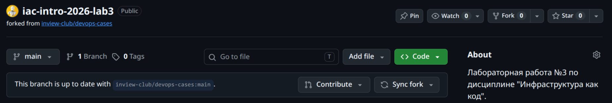

```bash
git checkout -b case-09-advanced
ls 09-create-base-image
```

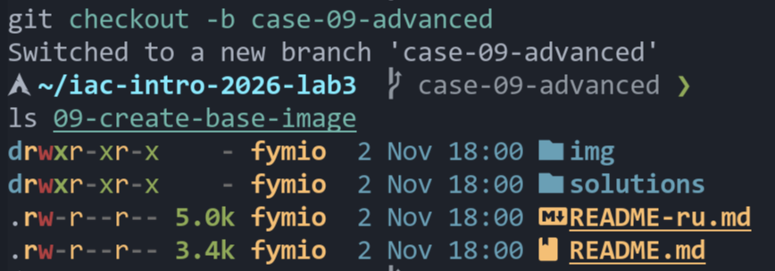

## Требования

```bash
sudo pacman -S --needed qemu-full libvirt virt-install dnsmasq edk2-ovmf libisoburn rsync docker packer vagrant
paru -S vagrant-libvirt
sudo systemctl enable --now libvirtd.socket docker
sudo usermod -aG libvirt,kvm,docker $USER
```

Проверка аппаратной виртуализации:

```bash
LC_ALL=C lscpu | grep Virtualization
ls /dev/kvm
```

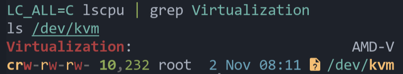

Версии docker и git:

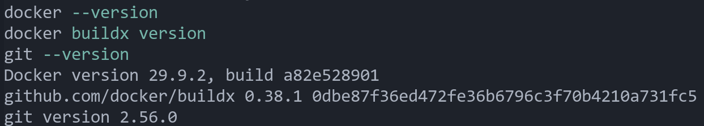

Версии packer, vagrant и плагин `vagrant-libvirt`:

```bash
packer --version
vagrant --version
vagrant plugin list
```

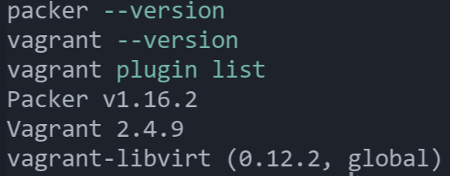

ISO-образ astra linux CE 1.7 в репозиторий не входит (из-за большого размера), его нужно положить в `packer/iso/astra.iso`. Контрольная сумма использованного образа:

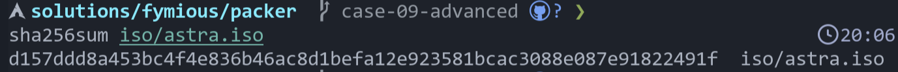

## Шаги для воспроизведения

1. Встроить preseed в копию iso (установщик Astra не может скачать его по сети в этой схеме):
   ```bash
   cd packer
   xorriso -indev iso/astra.iso -outdev iso/astra-preseed.iso \
     -boot_image any replay -map http/preseed.cfg /preseed.cfg
   sha256sum iso/astra-preseed.iso     # хэш записать в iso_checksum в astra.pkr.hcl
   ```
2. Собрать образ виртуалки через packer:
   ```bash
   packer init .
   packer validate .
   PACKER_LOG=1 packer build astra.pkr.hcl 2>&1 | tee build.log
   ```
   Установка проходит без участия пользователя. Packer сам вводит параметры загрузки, preseed отвечает на вопросы установщика, затем провижинер ставит `docker.io`, `debootstrap` и `rsync`. Сборка занимает около пяти минут.

   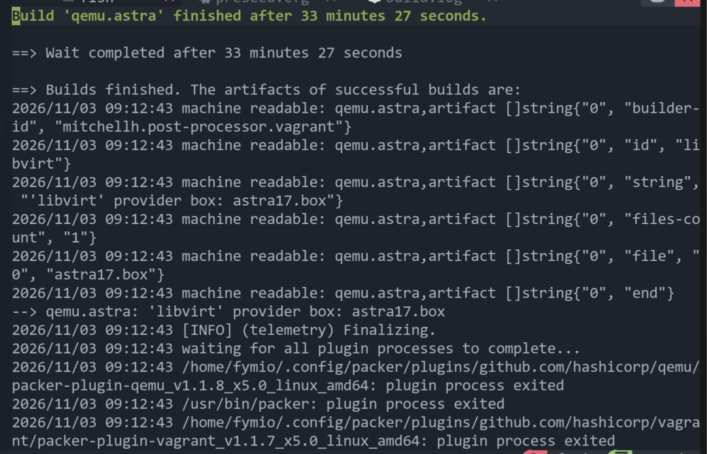
   На скриншоте выше сборка заняла полчаса, так как это была первая успешная, но не полностью автоматизированная сборка.

   В результат получается `astra17.box`.

   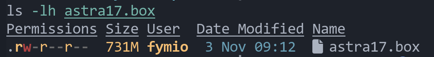

3. Поднять виртуалку через vagrant:
   ```bash
   cd ..
   vagrant box add astra17 packer/astra17.box
   vagrant up --provider=libvirt
   ```

   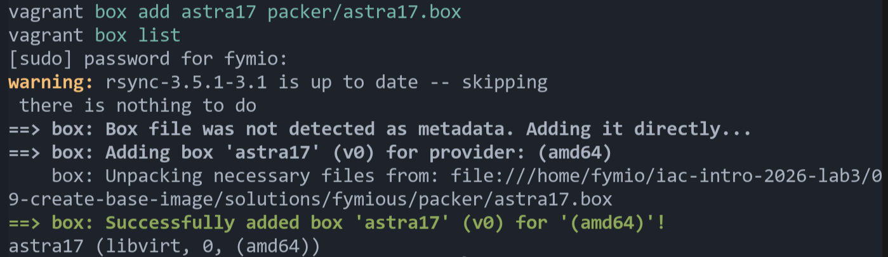

4. Собрать rootfs внутри виртуалки:
   ```bash
   sudo virsh net-dhcp-leases vagrant-libvirt
   scp scripts/build-rootfs.sh vagrant@<ip-виртуалки>:/tmp/
   ssh vagrant@<ip-виртуалки> bash /tmp/build-rootfs.sh
   ```
   Внутри виртуалки `debootstrap` разворачивает базовую систему в chroot, после чего каталог упаковывается в tar:

   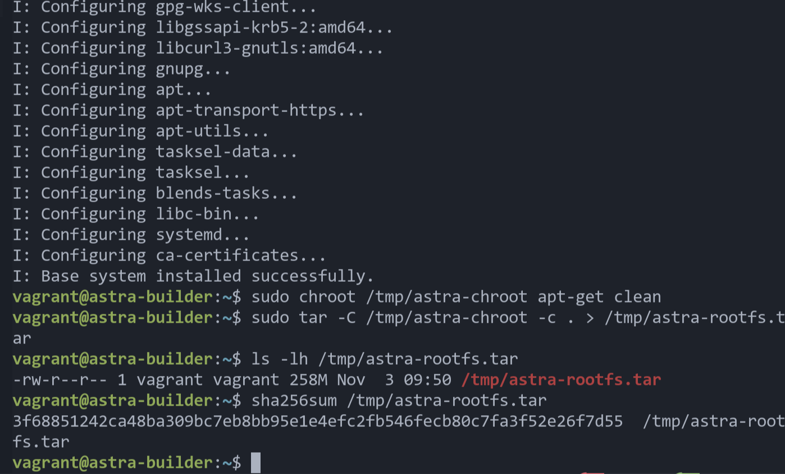

5. Скопировать tar на хост и импортировать в docker:
   ```bash
   scp vagrant@<ip-виртуалки>:/tmp/astra-rootfs.tar share/
   sha256sum share/astra-rootfs.tar
   docker import share/astra-rootfs.tar astra:1.7-base
   docker run --rm -it astra:1.7-base /bin/bash
   ```
   Контрольные суммы архива в виртуалки и на хосте совпали. Образ создан, в контейнере запускается оболочка, система определяется как astra linux:

   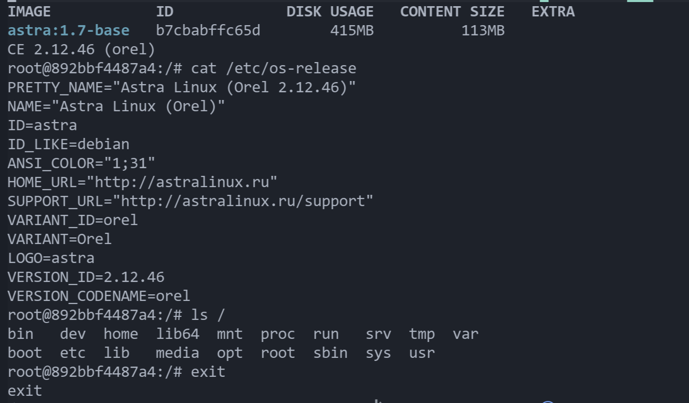

## Возникшие проблемы и их решение

| Проблема | Причина | Решение |
|---|---|---|
| Параметры загрузки не применялись | У Astra графическое меню gfxboot. Сначала в фокусе выбор языка, по `F2` открывается всплывающее меню | В `boot_command`: `<down><enter>` (язык), `<down>` (пункт "Install"), `<f2><esc>` (закрыть всплывающее меню), затем параметры, начиная с пробела |
| Установщик не мог скачать preseed по http | Сеть установщика недоступна из qemu в этой схеме | preseed встроен в iso и подключается через `preseed/file=/cdrom/preseed.cfg` |
| Установка вставала на лицензии | Специфичный для astra вопрос debconf | `astra-license/license=true` в параметрах загрузки и в preseed |
| Установка вставала на экране выбора языка | Вопрос про язык задаётся раньше, чем читается preseed | Параметры `debian-installer/locale`, `debian-installer/language`, `debian-installer/country` и `keyboard-configuration/xkb-keymap` в `boot_command` и ключи в preseed |
| Ошибка «Incorrect password» | astra требует пароль не короче 8 символов | Пароль `Vagrant123` |
| Установка вставала на установке grub | Диск для загрузчика не определялся | `grub-installer/bootdev=/dev/vda` |
| После первой загрузки не работал ssh | Служба `ssh` была отключена, сеть не настроена | `late_command` прописывает dhcp для `eth0` и включает `ssh` |
| `vagrant up` бесконечно ждал ip-адрес | `ufw` на хосте блокировал dhcp-запросы виртуалки на мосту libvirt | `sudo ufw allow in on virbr1 to any port 67 proto udp` (и правила для dns и маршрутизации) |
| `Storage source conflict with pool` | virt-manager уже использует `/var/lib/libvirt/images` как пул `images` | `lv.storage_pool_name = "images"` в vagrantfile |
| `vagrant ssh -c` не работал | Для входа настроен пароль, а не ключ | Подключение через обычный `ssh` и `scp` |

### Конфликт пула хранилища libvirt

При первом `vagrant up` плагин попытался создать собственный пул и упал с ошибкой:

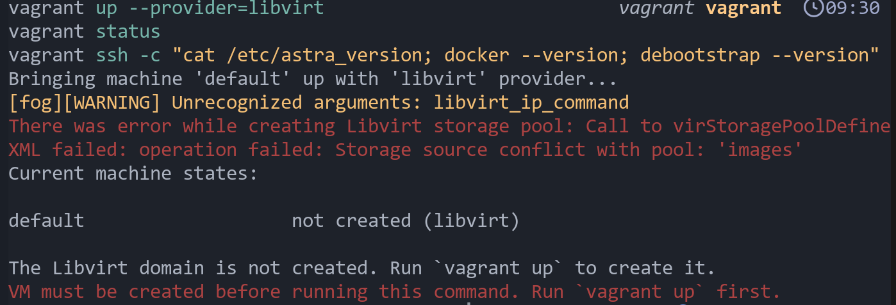

Каталог `/var/lib/libvirt/images` уже принадлежит активному пулу `images`:

```bash
virsh -c qemu:///system pool-list --all
virsh -c qemu:///system pool-dumpxml images | grep -E 'name|path'
```

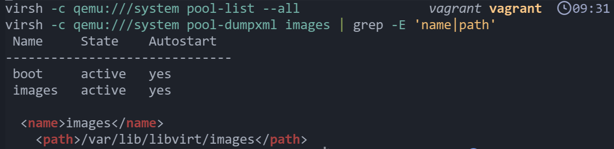

Поэтому в `Vagrantfile` указан существующий пул: `lv.storage_pool_name = "images"`.
